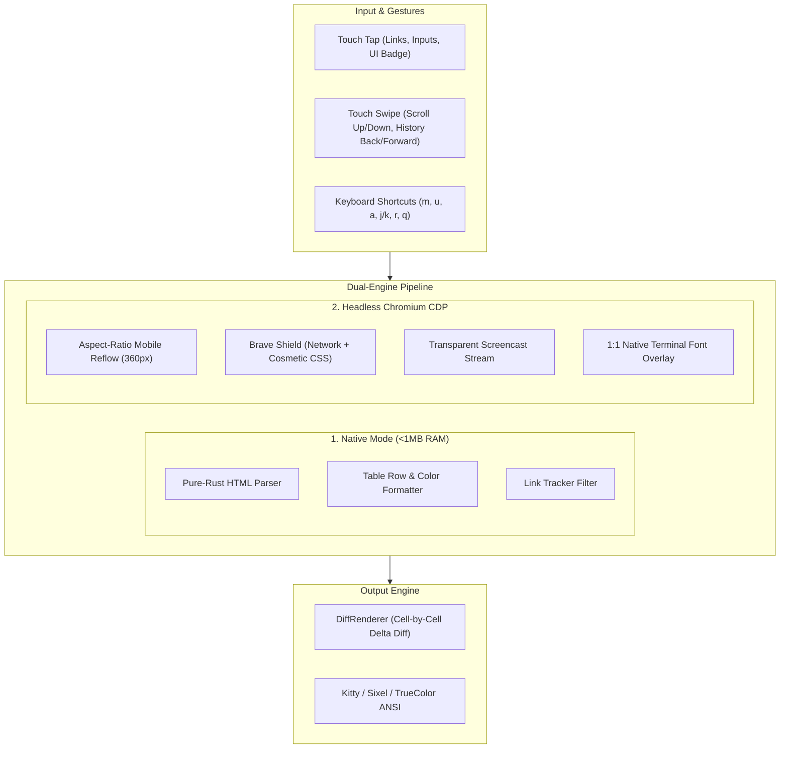

# ⚡ Termblitz

> **Blazing-Fast Visual Web Browser for Android Termux & Cross-Platform Terminals**  
> Unified 3-Mode Architecture: Pure-Rust Native Parser (<1MB RAM) & Headless Chromium CDP with 1:1 Razor-Sharp DOM Overlay & Brave-Style Ad Blocker.

Termblitz is a lightweight, mobile-optimized terminal browser crafted specifically for portrait screens on Android (Termux), Linux, macOS, and Windows. It combines a zero-overhead pure-Rust HTML layout engine with an advanced Headless Chromium hybrid renderer.

---

## 🚀 Key Features

* **Unified 3-Mode Rendering Architecture**:
  * 🟢 **Native Mode (`NATIVE`)**: Ultra-fast pure-Rust HTML/DOM parser and table layout engine. Zero Chromium overhead, **< 1MB RAM**, instant startup, 0% idle CPU.
  * 🟡 **CDP Hybrid Mode (`HYBRID [100%]`)**: Headless Chromium with 1:1 aspect-ratio-locked mobile portrait reflow (360px). Hides rasterized glyph blur via `-webkit-text-fill-color: transparent` while preserving true CSS computed text colors, overlaying DOM text and `<input>` fields as **razor-sharp native terminal characters** with multi-line word wrapping and guaranteed luminance contrast.
  * 🟣 **CDP Raw Mode (`RAW [100%]`)**: Full ANSI half-block / Kitty / Sixel raster bitmap rendering for viewing full-fidelity canvases, WebGL, or raw images without overlays.
* **🛡️ Integrated Brave-Style Ad & Tracker Shield (`SHIELD`)**:
  * **Network-Layer Request Blocker**: Intercepts and blocks tracking scripts, telemetry, and ad networks via Chromium's CDP (`Network.setBlockedURLs`).
  * **Cosmetic Ad Element Filtering**: Injects CSS rules that collapse and hide known ad containers, sponsored result slots, and banner iframes.
  * **Native HTML Sanitizer**: Strips ad networks and tracker links directly in the pure-Rust layout engine.
* **👆 Mobile Touch Gestures & Hit-Testing**:
  * **Interactive Element Tapping**: Tap links, buttons, or search `<input>` fields directly on your phone screen.
  * **Swipe Scrolling**: Fluid vertical drag and touch swipe scrolling.
  * **Swipe Gesture Navigation**: Swipe Right to go **Back** and Swipe Left to go **Forward** in browsing history.
  * **Touch-Enabled UI Bar**: Tap the top-left mode badge to cycle render modes; tap the address bar to enter a URL or search query.
* **🔍 Omnibox Search & Smart URL Resolver**:
  * Type plain text queries directly into the address bar to automatically launch a Google Search, or enter domain names and URLs.
* **⚡ DiffRenderer with Universal Protocol Support**:
  * Single-pass dirty-cell delta buffer with run-length encoding and a single atomic `write` syscall per frame.
  * Auto-detects terminal graphics capabilities: **Kitty Graphics Protocol**, **Sixel Graphics**, and **TrueColor Half-Block ANSI**.
* **📱 Adaptive Mobile Reflow, Unicode Grapheme Clustering & Contrast Engine**:
  * **Indic & Complex Script Grapheme Clustering**: Zero-width Unicode combining marks, Devanagari/Bengali/Telugu/Tamil/Gujarati/Kannada/Malayalam/Gurmukhi vowel matras, and viramas attach directly to their base character cell (`Cell.comb`) instead of advancing terminal columns—eliminating broken dotted circles (`◌`) and gaps in multilingual text.
  * **Center-Weighted Subpixel Downsampler**: Prevents 7x7 morphological dilation artifacts in `Raw` and `Hybrid` modes while preserving subtle 1px UI borders (such as search bar outlines) and crisp icon silhouettes.
  * **DOM Ancestor Background & Input Alignment**: Walks the DOM ancestor chain to resolve true solid button/card backgrounds (eliminating patchy per-letter background cells) and vertically centers `<input>` / search box overlays.
  * **Responsive Mobile Status & Address Bar**: Automatically adapts badge and telemetry widths on narrow portrait screens and expands to full width when typing URLs or search queries.

---

## ⌨️ Controls & Gestures

| Key / Gesture | Feature / Action |
| :--- | :--- |
| `m` / `F2` / **Tap Badge** | **Cycle Rendering Mode** (`Native` → `Hybrid` → `Raw` → `Native`) |
| `u` / `o` / `/` / **Tap Bar** | **Focus Search / Address Bar** (enter any URL or search term) |
| `a` | **Toggle Brave Ad & Tracker Shield** (`SHIELD` / `NO-AD`) |
| `[` / `]` or **Swipe R/L** | **History Back / Forward** (swipe right = back, swipe left = forward) |
| `j` / `k` or `↑` / `↓` | **Vertical Scroll** (vim keys & touch drag supported) |
| `PgUp` / `PgDn` / `Space` | **Half-Page Scroll** |
| `+` / `-` / `0` | **Zoom In / Zoom Out / Reset Zoom** (CDP modes) |
| `r` | **Reload Page / Reconnect** |
| `q` / `Esc` | **Exit Termblitz** |
| **Touch Screen Tap** | **Direct Link / Input Hit-Testing** (tap links to visit, tap inputs to type) |

---

## 🛠️ Architecture Overview



---

## 📦 Building & Running in Termux

### Prerequisites
Inside Termux / Debian proot:
```bash
pkg install -y proot-distro
proot-distro login debian
apt update && apt install -y build-essential cargo chromium curl
```

### Build Release Binary
```bash
cargo build --release
```
The optimized binary is compiled to `target/release/termblitz` (~1.1 MB).

### Run
```bash
./target/release/termblitz https://www.google.com
```

### CLI Flags
* `--native`: Start directly in pure-Rust Native mode (<1MB RAM)
* `--hybrid`: Start in CDP Hybrid mode (sharp text overlay + visual cards)
* `--raw`: Start in CDP Raw bitmap mode
* `--kitty`: Force Kitty graphics protocol
* `--sixel`: Force Sixel graphics protocol
* `--ansi`: Force TrueColor half-block ANSI rendering

---

## 📄 License
MIT License.
