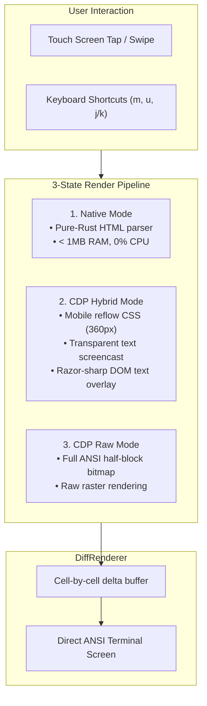

# ⚡ Termblitz

> **Blazing-Fast Visual Web Browser for Android Termux**  
> Unified 3-Mode Architecture: Pure-Rust Native Parser (<1MB RAM) & Headless Chromium CDP with Razor-Sharp DOM Overlay.

Termblitz is a lightweight, mobile-optimized terminal browser crafted specifically for portrait screens on Android (Termux). It solves the classic terminal browser dilemma by combining a zero-overhead pure-Rust HTML layout engine with an advanced Headless Chromium hybrid renderer.

---

## 🚀 Key Features

* **Unified 3-Mode Rendering Architecture**:
  * 🟢 **Native Mode (`NATIVE`)**: Ultra-fast pure-Rust HTML/DOM parser and table layout engine. Zero Chromium overhead, **< 1MB RAM**, instant startup, 0% idle CPU.
  * 🟡 **CDP Hybrid Mode (`HYBRID [200%]`)**: Headless Chromium with Option C mobile portrait CSS reflow (360px). Captures clean background cards and images via transparent text screencasts, while DOM text nodes are extracted and printed as **razor-sharp native terminal characters** with 1:1 coordinate alignment. Zero blurry text bleed!
  * 🟣 **CDP Raw Mode (`RAW [200%]`)**: Full ANSI half-block raster bitmap rendering for viewing full-fidelity canvases, WebGL, or raw images without overlays.
* **Smart Adaptive Default**: Automatically opens text-dense pages (articles, documentation, Hacker News, Wikipedia) in Native mode, switching to CDP Hybrid mode for modern SPAs.
* **Touch & Mouse Hit-Testing**: Tap links directly on your phone screen to navigate.
* **DiffRenderer**: High-efficiency delta rendering that only updates changed terminal cells.
* **Mobile Portrait Reflow**: Dynamic CSS injection that wraps wide web layouts into a clean single-column portrait view.

---

## ⌨️ Controls & Navigation

| Key | Action |
| :--- | :--- |
| `m` / `F2` | **Cycle Rendering Mode** (`Native` → `Hybrid` → `Raw` → `Native`) |
| `u` | **Focus Address Bar** (enter any URL or search term) |
| `j` / `k` or `↑` / `↓` | Scroll up / down (vim keys supported) |
| `PgUp` / `PgDn` | Half-page scroll |
| `+` / `-` / `=` | Zoom In / Zoom Out / Reset Zoom (CDP modes) |
| `r` | Reload page / retry connection |
| `q` / `Esc` | Exit Termblitz |
| **Touch Screen** | Tap links directly or swipe to scroll |

---

## 🛠️ Architecture



---

## 📦 Building & Running in Termux

### Prerequisites
Inside Termux / Debian proot:
```bash
pkg install -y proot-distro
proot-distro login debian
apt update && apt install -y build-essential cargo chromium
```

### Build Release Binary
```bash
cargo build --release
```
The optimized binary is compiled to `target/release/termblitz` (~1.1 MB).

### Run
```bash
./target/release/termblitz https://www.google.com
```

---

## 📄 License
MIT License.
